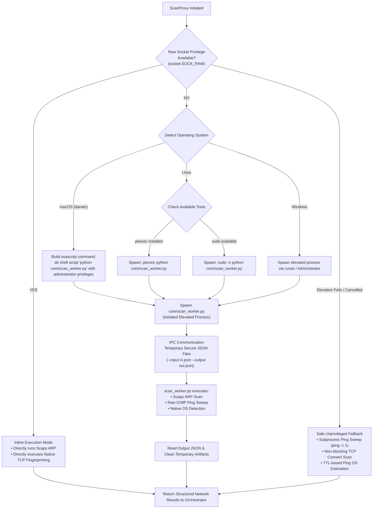

# 🛡️ Netscan — Enterprise Network Security Scanner & Intelligence Platform

[](https://www.python.org/)
[](https://riverbankcomputing.com/software/pyqt/)
[](https://scapy.net/)
[-brightgreen.svg?logo=pytest&logoColor=white)](tests/)
[](#cross-platform-installation)
[](#legal-disclaimer)

**Netscan** is a professional, enterprise-grade network security scanner, device reconnaissance system, and OSINT intelligence workbench. Built with Python, PyQt6, and an asynchronous packet engine (`asyncio` + `scapy`), Netscan provides security teams, network administrators, and penetration testers with a non-intrusive auditing tool that discovers network assets, fingerprints operating systems and services, detects IoT vulnerabilities, benchmarks latency, and visualizes network topology in real time.

---

## 📑 Table of Contents

- [Key Capabilities & Features](#-key-capabilities--features)
- [Architecture & Workflow Diagrams](#-architecture--workflow-diagrams)
  - [High-Level System Architecture](#1-high-level-system-architecture)
  - [End-to-End Scan Pipeline](#2-end-to-end-scan-pipeline)
  - [Privilege Separation & Elevation Proxy](#3-privilege-separation--elevation-proxy)
- [Project Directory Structure](#-project-directory-structure)
- [System Requirements & Dependencies](#-system-requirements--dependencies)
- [Cross-Platform Installation](#-cross-platform-installation)
  - [1. System Package Requirements](#1-system-package-requirements)
  - [2. Python Virtual Environment Setup](#2-python-virtual-environment-setup)
- [Execution Steps](#-execution-steps)
  - [Running with Full Privileges (Recommended)](#running-with-full-privileges-recommended)
  - [Running in Unprivileged Mode](#running-in-unprivileged-mode)
- [Configuration Guide (`netscan_config.yaml`)](#-configuration-guide-netscan_configyaml)
  - [Threat Intelligence (AbuseIPDB)](#threat-intelligence-abuseipdb)
  - [Custom Scan Profiles](#custom-scan-profiles)
- [User Interface & Operation Guide](#-user-interface--operation-guide)
  - [3D Metric Dashboard](#1-3d-metric-dashboard)
  - [Interactive D3.js Topology Map](#2-interactive-d3js-topology-map)
  - [Tokyo Night OSINT Inspection Panel](#3-tokyo-night-osint-inspection-panel)
  - [Automated Scan Scheduler](#4-automated-scan-scheduler)
  - [Continuous Network Monitoring](#5-continuous-network-monitoring)
  - [Historical Comparison & Diff Engine](#6-historical-comparison--diff-engine)
  - [Multi-Format Audit Exporting (PDF / CSV / JSON / HTML)](#7-multi-format-audit-exporting)
- [Testing & Validation](#-testing--validation)
- [Security Model & Troubleshooting](#-security-model--troubleshooting)
- [Legal Disclaimer](#-legal-disclaimer)

---

## 🚀 Key Capabilities & Features

### 📡 Multi-Phase Asset Discovery
* **Subnet Auto-Detection**: Automatically identifies the local IPv4 interface, gateway, and CIDR subnet mask without manual input.
* **Dual-Engine Discovery**: Combines high-speed ICMP Ping Sweeps with low-level Scapy ARP broadcast scanning for authoritative host discovery on local L2 segments and routed L3 networks.
* **Domain & CIDR Resolution**: Resolves single IPv4 addresses, domain names (`google.com`), `localhost`, or arbitrary CIDR ranges (up to 65,536 hosts with built-in safety bounds).

### ⚡ Asynchronous Port & Latency Engine
* **High-Throughput Concurrent Probing**: Built on native Python `asyncio` with configurable worker pools (up to 500 concurrent socket connections) and `uvloop` acceleration on Unix platforms.
* **Profile-Based Scanning**: Switch between curated presets: *Top 20 Default*, *Web Only*, *Databases Only*, *SSH & Remote*, and *Top 100 Common Services*, or define custom port profiles in YAML.
* **Latency & Bandwidth Estimation**: Measures round-trip connection latency (ms) per open port and extrapolates link quality metrics (LAN / Fast Link, Medium, Low, WAN).

### 🔍 Deep Fingerprinting & OS Detection
* **Triple-Tier OS Identification**:
  1. *Native TCP SYN Probing*: Sends raw TCP packets to inspect TTL and initial TCP window sizes (distinguishing macOS/iOS, Linux 2.4–6.x, Windows Server/10/11, FreeBSD, and network appliances).
  2. *Nmap OS Fingerprinting*: Delegates to system `nmap -O` for full signature database matching when available.
  3. *Ping TTL Heuristic Fallback*: Safe unprivileged heuristic deduction from ICMP echo replies.
* **Service Banner Grabbing**: Socket-level protocol interrogation and regex parsing across SSH (OpenSSH, Dropbear), HTTP servers (Apache, Nginx, IIS, lighttpd), FTP daemons (vsftpd, ProFTPD, Pure-FTPd), mail relays, and database listeners.
* **IEEE MAC OUI Resolution**: Local hardware vendor database resolution using `mac-vendor-lookup` with automated vendor sanitization.

### 🌐 OSINT & Web Intelligence
* **HTTP/HTTPS Security Headers**: Analyzes web endpoints on ports 80, 443, 8080, and 8443. Validates mandatory defense headers: `Strict-Transport-Security` (HSTS), `Content-Security-Policy` (CSP), `X-Frame-Options`, and `X-Content-Type-Options`.
* **X.509 TLS/SSL Certificate Auditing**: Inspects SSL certificate chains using `cryptography`. Extracts issuer, subject, cipher suites, protocol version, and alerts on expired certificates.
* **DNS Intelligence**: Queries PTR reverse DNS records for discovered IPs, plus authoritative `A`, `MX`, `TXT`, and `NS` records for mapped domains via `dnspython`.
* **Geolocation & BGP Routing**: Extracts Country, Region, City, Latitude, Longitude, ISP, ASN, and Organization for public IP targets.
* **WHOIS Ownership Extraction**: Queries registrar data, creation dates, expiration dates, and nameservers via `python-whois`.
* **Threat Intelligence**: Connects to the **AbuseIPDB API v2** to check public IP abuse confidence scores, report counts, and threat categories (e.g., botnets, brute-force, malware).

### 🤖 IoT & Embedded System Classification
* Automated rule-based engine (`IoTClassifier`) cross-references device MAC OUIs (Espressif, Raspberry Pi, Tuya, Sonoff, Hikvision, Dahua, Axis, Ring, Sony, etc.), open IoT/CCTV control ports (554 RTSP, 1883 MQTT, 37777 Dahua, 8000/34567 DVR), and server banners to pinpoint smart devices, cameras, and embedded sensors.

### ⚠️ Non-Intrusive Vulnerability & Risk Engine
* **Dynamic Risk Scoring (0–100)**: Evaluates exposed ports, plaintext protocols, outdated software banners, missing web headers, and certificate flaws.
* **Curated SQLite CVE Database**: Cross-references parsed banners against an internal CVE database covering high-profile exploits (e.g., vsftpd 2.3.4 backdoor, Apache 2.4.49 path traversal, OpenSSL Heartbleed, xz backdoor).
* **Live CIRCL Vulnerability Enrichment**: Queries the CIRCL CVE search API asynchronously with aggressive timeouts to provide real-time vulnerability summaries.
* **End-of-Life (EOL) & Backdoor Detection**: Flags obsolete and unpatched server builds automatically.

### 📊 Enterprise PyQt6 GUI & Visual Workspace
* **Tokyo Night Cyberpunk Dark Theme & Clean Light Mode**: Ultra-refined styling inspired by modern IDEs, with vibrant status badges and high-contrast typography.
* **Interactive D3.js Force-Directed Topology Graph**: Visualizes live network structure directly in PyQt6 via `QWebEngineView`, grouping nodes by risk color with zooming, panning, and force-physics drag controls. Exportable as standalone portable HTML.
* **Database & Scan Diff Engine**: Backed by SQLite in WAL (Write-Ahead Logging) mode. Compares any two historical scans to identify newly joined assets, dropped hosts, port modifications, and score variances.
* **Background Scheduler**: Automate recurring or one-shot scans directly from the GUI.
* **Continuous Monitor Mode**: Real-time network watcher emitting alert notifications when new devices appear or new high-risk ports open.

---

## 📐 Architecture & Workflow Diagrams

### 1. High-Level System Architecture

```mermaid
flowchart TB
    subgraph UI_Layer ["🖥️ Presentation Layer (PyQt6)"]
        GUI["NetscanApp (QMainWindow)\n• Tokyo Night Dark / Light Theme\n• 3D Metric KPI Cards\n• Responsive Asset Grid\n• Tokyo Night OSINT Inspector"]
        D3Topo["Interactive Topology Map\n(QWebEngineView + D3.js v7)"]
        HistoryUI["Scan History & Diff Viewer\n• Added / Removed / Changed Assets"]
        SchedUI["Scheduler & Monitor Manager\n• Recurring Scans & Event Alerts"]
    end

    subgraph Core_Layer ["⚙️ Core Orchestration & Control Layer"]
        Orchestrator["Orchestrator (orchestrator.py)\n• Target Parser & CIDR Resolver\n• Pipeline Concurrency Manager\n• JSON Schema Pruning Engine"]
        Proxy["ScanProxy (privilege_proxy.py)\n• Raw Socket Detection\n• Subprocess Elevation Manager\n• Safe Fallback Selector"]
        Scheduler["ScanScheduler (scheduler.py)\n• Thread-Safe Job Queue\n• Async Background Runner"]
        Monitor["NetworkMonitor (monitor.py)\n• Periodic Delta Scanner\n• Live Anomaly & Port Change Emitter"]
    end

    subgraph Worker_Layer ["🔒 Privilege-Separated Worker (Subprocess)"]
        ElevatedWorker["scan_worker.py (Elevated)\nSpawned via sudo -n / pkexec / osascript\n• Scapy ARP Scan\n• Raw ICMP Ping Sweep\n• SYN OS Fingerprinting"]
    end

    subgraph Analysis_Engines ["🔬 Analysis & Reconnaissance Engines"]
        ScannerMod["Port Scanner (port_scan.py)\n• Asyncio TCP Connect (Max 500)\n• Latency / Bandwidth Estimator"]
        FingerprintMod["Fingerprint Suite\n• Native TCP SYN Fingerprint\n• Nmap Integration (-O)\n• Service Banner Parsing\n• IEEE MAC OUI Lookup"]
        WebIntelMod["Web & TLS Intelligence\n• Security Headers (HSTS, CSP)\n• X.509 Certificate Parser"]
        OSINTMod["OSINT & Intelligence Suite\n• DNS (A, MX, TXT, NS, PTR)\n• Geolocation & ASN Lookup\n• WHOIS Domain Ownership\n• AbuseIPDB Threat Intel API"]
        IoTMod["IoT Classifier\n• OUI + IoT Ports (RTSP, MQTT)\n• Camera / Appliance Detection"]
        RiskEngine["Risk Engine (risk_analysis.py)\n• 0-100 Scoring Algorithm\n• ServiceVersionDB (EOL Detection)\n• Local CVE SQLite DB + CIRCL API"]
    end

    subgraph Storage_Export ["💾 Storage & Reporting Layer"]
        DB[(SQLite netscan_history.db)\n• WAL Concurrency Mode\n• Historical Scan Diffs]
        CVEDB[(SQLite cve_database.db)\n• Known Vulnerability Signatures]
        ExportUtil["Export Utility (export.py)\n• Executive PDF Reports (ReportLab)\n• Structured CSV / Clean JSON\n• Standalone D3.js HTML Map"]
    end

    GUI --> Orchestrator
    GUI --> HistoryUI
    GUI --> SchedUI
    D3Topo -.-> GUI

    Orchestrator --> Proxy
    Proxy -->|Privileged Mode| ScannerMod
    Proxy -->|Privileged Mode| FingerprintMod
    Proxy -->|Unprivileged Elevation Required| ElevatedWorker

    Orchestrator --> ScannerMod
    Orchestrator --> FingerprintMod
    Orchestrator --> WebIntelMod
    Orchestrator --> OSINTMod
    Orchestrator --> IoTMod
    Orchestrator --> RiskEngine

    RiskEngine --> CVEDB
    Orchestrator --> DB
    HistoryUI --> DB
    Scheduler --> Orchestrator
    Monitor --> Orchestrator

    GUI --> ExportUtil
```

---

### 2. End-to-End Scan Pipeline

```mermaid
sequenceDiagram
    autonumber
    actor User as Security Auditor
    participant UI as NetscanApp GUI
    participant Orch as Orchestrator
    participant Proxy as ScanProxy
    participant Net as Target Network
    participant Intel as Fingerprint & OSINT Suite
    participant Risk as RiskEngine
    participant DB as SQLite History DB

    User->>UI: Enter Target ('auto', CIDR, IP, Domain) & Click 'Start Scan'
    UI->>Orch: scan_network(target, progress_callback)
    
    rect rgb(25, 30, 45)
        note over Orch: Phase 1: Target Resolution & Asset Discovery
        Orch->>Orch: Resolve Domain / Detect Subnet CIDR
        Orch->>Proxy: run_ping_sweep(ip_list)
        Proxy->>Net: ICMP Echo Requests (Parallel Async)
        Net-->>Proxy: Active IP Responses
        Orch->>Proxy: run_arp_scan(active_ips)
        Proxy->>Net: Scapy ARP Broadcasts
        Net-->>Proxy: Hardware MAC Responses
    end

    rect rgb(20, 35, 35)
        note over Orch, Intel: Phase 2: Concurrent Asset Reconnaissance
        loop For each Live Host
            Orch->>Net: Async TCP Port Scan (Selected Profile / Concurrency: 500)
            Net-->>Orch: Open Ports & Round-Trip Latency
            Orch->>Net: Banner Grabbing (SSH, HTTP, FTP, SMTP, DB)
            Net-->>Orch: Service Banners
            Orch->>Intel: Native TCP SYN / Nmap OS Detection
            Intel-->>Orch: Operating System Guess
            
            opt HTTP / HTTPS Open (80, 443, 8080, 8443)
                Orch->>Intel: Fetch HTTP Headers & TLS Certificate
                Intel-->>Orch: Security Headers Status & X.509 Validity
            end

            opt Public IP Address
                Orch->>Intel: Geolocation, ASN, WHOIS, AbuseIPDB
                Intel-->>Orch: Location, Provider, Threat Score
            end

            Orch->>Intel: Query PTR & Domain DNS Records (A, MX, TXT, NS)
            Intel-->>Orch: DNS Records
            Orch->>Intel: Classify IoT (MAC OUI, Ports, Banners)
            Intel-->>Orch: IoT Status & Device Type
        end
    end

    rect rgb(45, 25, 30)
        note over Orch, Risk: Phase 3: Vulnerability Analysis & Scoring
        Orch->>Risk: analyze(open_ports, banners, web_intel)
        Risk->>Risk: Match against Local CVE DB & CIRCL API
        Risk->>Risk: Check End-of-Life Software & Exposed Sensitive Ports
        Risk-->>Orch: Risk Level (Low/Med/High), Risk Score (0-100), Risk Reasons
    end

    rect rgb(30, 30, 45)
        note over Orch, DB: Phase 4: Output Synthesis & Persistence
        Orch->>Orch: Prune Null / Empty Attributes (Pristine JSON)
        Orch->>DB: save_scan(target, devices)
        DB-->>Orch: Saved Confirmation (Timestamp)
        Orch-->>UI: Return Structured Asset Intelligence
    end

    UI->>UI: Update 3D Metric KPI Cards
    UI->>UI: Populate Tokyo Night Asset Table
    UI->>UI: Render Force-Directed D3.js Topology
    UI-->>User: Scan Completed (Audio / Visual Alert)
```



---

### 3. Privilege Separation & Elevation Proxy

Netscan implements a clean privilege separation architecture. Running an entire GUI application as `root` introduces security risks; conversely, low-level network operations (such as raw Scapy ARP frames and TCP SYN packet crafting) require elevated privileges (`CAP_NET_RAW` / root). 

`ScanProxy` dynamically resolves this boundary:



---

## 📁 Project Directory Structure

```text
Netscan/
├── main.py                     # Primary GUI application launcher
├── netscan_config.yaml         # Master YAML configuration file
├── requirements.txt            # Python package dependencies
├── pytest.ini                  # Pytest configuration & asyncio mode settings
├── cve_database.db             # SQLite database storing curated vulnerability signatures
├── netscan_history.db          # SQLite persistent storage for scan history & diffs
│
├── core/                       # Core orchestration, monitoring, and privilege layer
│   ├── orchestrator.py         # Primary scan pipeline coordinator & schema pruner
│   ├── privilege_proxy.py      # Transparent privilege detection & IPC elevation proxy
│   ├── scan_worker.py          # Elevated CLI worker executed under root/administrator
│   ├── monitor.py              # Continuous network monitoring & delta-detection engine
│   ├── scheduler.py            # Thread-safe scan job scheduler (one-shot & recurring)
│   └── database.py             # SQLite WAL-mode interface for history and diff reports
│
├── scanner/                    # Low-level network scanning modules
│   ├── arp_scan.py             # Asynchronous Scapy ARP broadcast scanner
│   ├── ping_sweep.py           # Multi-threaded / async ICMP echo sweeper
│   └── port_scan.py            # High-concurrency async TCP scanner & latency estimator
│
├── fingerprint/                # Asset reconnaissance & OSINT enrichment modules
│   ├── os_detection.py         # Native TCP SYN, Nmap, and Ping TTL operating system classifier
│   ├── service_detection.py    # Socket banner grabber with protocol payload handshakes
│   ├── mac_lookup.py           # Hardware vendor resolver (IEEE OUI database)
│   ├── web_intelligence.py     # HTTP security header analyzer & X.509 TLS certificate auditor
│   ├── dns_intelligence.py     # PTR reverse lookups and authoritative A, MX, TXT, NS resolver
│   ├── geolocation.py          # IP-API geolocation, ISP, and ASN resolver
│   ├── whois_lookup.py         # WHOIS registrar, creation date, and expiration auditor
│   └── threat_intel.py         # AbuseIPDB API threat intelligence client
│
├── iot_detection/              # Embedded device classification
│   └── iot_classifier.py       # Heuristic classifier combining OUIs, ports, and banners
│
├── risk_engine/                # Vulnerability analysis & scoring
│   ├── risk_analysis.py        # Central 0–100 risk scoring algorithm
│   ├── service_versions.py     # Structured version extractor & EOL detector
│   ├── cve_database.py         # Local SQLite CVE database search interface
│   └── cve_matcher.py          # Banner heuristic matcher & CIRCL CVE API client
│
├── ui/                         # PyQt6 Graphical User Interface
│   └── app.py                  # Main GUI (Tokyo Night theme, D3.js topology, 3D cards)
│
├── utils/                      # Helper utilities
│   ├── config.py               # Singleton configuration manager loading netscan_config.yaml
│   ├── export.py               # PDF (ReportLab), CSV (Pandas), and JSON export routines
│   └── logger.py               # Standardized logging formatter
│
└── tests/                      # Automated test suite (40 test cases)
    ├── test_database.py        # SQLite persistence, thread safety, WAL, and diff verification
    ├── test_fingerprint.py     # TCP SYN heuristics, TTL parsing, and TLS extraction tests
    ├── test_risk_engine.py     # Risk scoring, CVE matching, and header penalty checks
    └── test_scanner.py         # Target resolution, CIDR bounds, and schema pruning tests
```

---

## 💻 System Requirements & Dependencies

### Hardware Requirements
* **RAM**: Minimum 2 GB (4 GB recommended for large `/16` CIDR sweeps).
* **Network Interface**: Ethernet or Wi-Fi adapter supporting packet broadcast (promiscuous mode not strictly required for standard ARP).
* **Storage**: Under 50 MB disk space.

### Software Requirements
* **Python**: `3.8`, `3.9`, `3.10`, `3.11`, or `3.12`.
* **Nmap** *(Optional, recommended)*: Enhances OS detection accuracy with the `-O` flag.
* **PyQt6 & QtWebEngine**: Supported on modern desktop operating systems with graphical displays.

---

## 🔧 Cross-Platform Installation

### 1. System Package Requirements

#### macOS
Install `nmap` using [Homebrew](https://brew.sh/):
```bash
brew install nmap
```

#### Ubuntu / Debian / Kali Linux
Install `nmap` and raw packet capture libraries:
```bash
sudo apt update
sudo apt install -y nmap libpcap-dev
```

#### Fedora / RHEL
```bash
sudo dnf install -y nmap libpcap-devel
```

#### Windows
1. Download and install Nmap with **Npcap** from [nmap.org/download.html](https://nmap.org/download.html).
2. During Npcap setup, ensure **"Install Npcap in WinPcap API-compatible Mode"** is checked.

---

### 2. Python Virtual Environment Setup

Clone the repository and initialize an isolated virtual environment:

```bash
# 1. Clone or navigate to the project directory
cd /path/to/Netscan

# 2. Create a virtual environment
python3 -m venv venv

# 3. Activate the virtual environment
# On macOS / Linux:
source venv/bin/activate
# On Windows (PowerShell):
.\venv\Scripts\Activate.ps1
# On Windows (Command Prompt):
.\venv\Scripts\activate.bat

# 4. Upgrade pip and install all dependencies
pip install --upgrade pip
pip install -r requirements.txt
```

> [!NOTE]
> On macOS and Linux, `uvloop` is automatically installed via `requirements.txt` to accelerate `asyncio` networking. Windows environments will automatically fall back to standard `asyncio` event loops.

---

## ⚡ Execution Steps

### Running with Full Privileges (Recommended)

Running with administrative privileges allows Netscan to bind raw sockets for **ARP hardware resolution**, **TCP SYN OS fingerprinting**, and low-level ICMP ping sweeps without needing subprocess escalation prompts.

#### macOS
```bash
# Activate your virtual environment first
source venv/bin/activate

# Execute using sudo with the virtual environment Python interpreter
sudo $(which python) main.py
```

#### Linux
```bash
source venv/bin/activate
sudo $(which python) main.py
```

> [!TIP]
> **Linux Capability Alternative (No Root Required):**
> If you prefer not running the Python interpreter under `sudo`, grant raw network privileges to Python directly:
> ```bash
> sudo setcap cap_net_raw,cap_net_admin=eip $(readlink -f $(which python3))
> python main.py
> ```

#### Windows
1. Open **Command Prompt** or **PowerShell** as **Administrator** (*Right-click -> "Run as administrator"*).
2. Activate your virtual environment:
   ```powershell
   .\venv\Scripts\Activate.ps1
   ```
3. Run:
   ```powershell
   python main.py
   ```

---

### Running in Unprivileged Mode

You can run Netscan as a standard user:
```bash
python main.py
```
* The GUI displays a **`🔒 Unprivileged`** badge in the top bar.
* When executing ARP scans or OS fingerprinting, Netscan's `ScanProxy` prompts for privilege escalation via native GUI dialogs (`osascript` on macOS, `pkexec` on Linux).
* If elevation is cancelled, Netscan safely defaults to non-root ICMP ping sweeps and standard non-blocking TCP connect scans.

---

## ⚙️ Configuration Guide (`netscan_config.yaml`)

Netscan loads its settings from `netscan_config.yaml` on startup. You can customize timeouts, worker threads, ports, IoT identifiers, and third-party API credentials:

```yaml
# Netscan Configuration File

# Core Settings
core:
  log_level: "INFO"             # DEBUG, INFO, WARNING, ERROR, CRITICAL
  timeout: 2                    # Default network timeout in seconds
  max_threads: 100              # Worker thread concurrency pool
  maximum_scan_hosts: 65536     # Safety ceiling to prevent accidental /8 sweeps
  rate_limit_per_minute: 45     # External API rate limit (e.g. CIRCL, AbuseIPDB)

# Scanner Settings
scanner:
  # Ports to scan if no profile is selected
  ports: [21, 22, 23, 25, 53, 80, 110, 111, 135, 139, 143, 443, 445, 993, 995, 1723, 3306, 3389, 5900, 8080, 8443]
  
  # Excluded IP addresses or CIDR blocks skipped during discovery
  exclude_ips: []

# IoT Detection Settings
iot:
  ports: [554, 1883, 8080, 80, 443, 37777, 8000, 34567, 81, 82]
  mac_oui: 
    - "Espressif"
    - "Raspberry Pi"
    - "Tuya"
    - "Sonoff"
    - "Amazon"
    - "Google"
    - "Ring"
    - "Dahua"
    - "Hikvision"
    - "Axis"
    - "Panasonic"
    - "Sony"

# Threat Intelligence (AbuseIPDB Integration)
threat_intel:
  # Free API key from https://www.abuseipdb.com/api
  abuseipdb_key: "YOUR_ABUSEIPDB_API_KEY_HERE"

# Continuous Network Monitoring
monitoring:
  interval: 300                 # Interval in seconds between continuous scans (5 min)

# Data Enrichment
enrichment:
  whois_enabled: true           # Enable/disable WHOIS domain resolution
```

### Threat Intelligence (AbuseIPDB)
To enable real-time malicious IP reputation lookups:
1. Register for a free account at [AbuseIPDB](https://www.abuseipdb.com/).
2. Navigate to **Account -> API Keys** and generate a key.
3. Paste the key into `netscan_config.yaml` under `threat_intel.abuseipdb_key`.
4. Any scanned public IP will automatically display abuse confidence scores, report counts, and category classifications in the OSINT panel.

### Custom Scan Profiles
Define custom port scanning profiles directly in `netscan_config.yaml`:
```yaml
scanner:
  active_profile: "Web Only"
  profiles:
    "Industrial ICS": [102, 502, 44818, 47808]
    "VoIP Services": [5060, 5061, 10000]
```

---

## 🖥️ User Interface & Operation Guide

### 1. 3D Metric Dashboard
Upon launching, Netscan greets you with real-time stat cards:
* **TOTAL**: Total IP addresses within the evaluated target scope.
* **ACTIVE**: Live hosts answering ARP or ICMP ping probes.
* **OFFLINE**: Unreachable or non-responsive targets.
* **SECURE**: Active hosts with low risk scores and zero critical alerts.
* **RISK**: Assets with medium vulnerability levels (score 30–69).
* **CRITICAL**: High-risk assets (score 70–100) requiring immediate remediation.
* **IoT**: Discovered smart devices, IP cameras, or embedded controllers.

---

### 2. Interactive D3.js Topology Map
Click the **"Topology Map"** tab to view a live, force-directed graph:
* **Center Node (Blue)**: Represents the Scanner host / Default Gateway.
* **Safe Devices (Green)**: Hosts with no detected vulnerabilities.
* **IoT Devices (Purple)**: Identified embedded and smart hardware.
* **Medium Risk (Orange)**: Assets exposing warnings or outdated services.
* **Critical Risk (Red)**: Assets exposing severe vulnerabilities (e.g. Telnet, unpatched backdoors).
* **Controls**: Click and drag nodes, scroll to zoom in/out, pan across large subnets.
* **Export**: Click **"Export Topology"** in the top bar to save a standalone, self-contained `netscan_topology.html` file that can be shared and opened in any browser without Netscan installed.

---

### 3. Tokyo Night OSINT Inspection Panel
Selecting any row in the **Grid View** immediately populates the right-hand inspection terminal:
* **Asset Header**: IP Address, Status badge (Active/Inactive), and Numerical Risk Score (0–100).
* **Risk & Profiling**: Specific remediation reasons (e.g., *Critical service exposed: Telnet (Port 23)*, *Expired TLS certificate*).
* **Web Intelligence**: Server software, identified tech stacks, and presence of crucial HTTP security headers (`Strict-Transport-Security`, `Content-Security-Policy`).
* **TLS Auditing**: Cipher suite, SSL/TLS protocol version, and expiration status.
* **Network & Geolocation**: ISP name, Autonomous System Number (ASN), City, Region, Country, and Reverse DNS (PTR).
* **DNS Intelligence**: Domain name, `A` records, `MX` mail servers, `TXT` verification strings, and authoritative `NS` nameservers.
* **Services & Banners**: Raw protocol banners with clean syntax formatting.

---

### 4. Automated Scan Scheduler
Click the **"📅 Scheduler"** tab to configure automated auditing tasks:
1. Enter the target network (e.g., `192.168.1.0/24`).
2. Set the interval in minutes (e.g., `30` or `1440` for daily audits).
3. Assign an optional label (e.g., `Office Floor 2 LAN`).
4. Click **"➕ Add Schedule"**.
5. Click **"▶ Start Scheduler"** to run automated background scans. Results are written directly to the database and updated in the UI.

---

### 5. Continuous Network Monitoring
Click the **"▶ Monitor"** toggle button in the top navigation bar:
* Netscan enters daemon monitoring mode on the active target network.
* Runs periodic sweeps in the background at the interval configured in `netscan_config.yaml`.
* Emits real-time visual alerts and logs whenever:
  - A **new device** joins the network.
  - A previously known device **goes offline**.
  - A new **high-risk port** is opened on an existing asset.

---

### 6. Historical Comparison & Diff Engine
Click the **"Scan History"** tab to view all previous scans stored in `netscan_history.db`:
* **Load Selected Scan**: Restores a past scan into the active Grid View and regenerates the interactive topology map.
* **Compare Selected Scans**: Hold `Ctrl` (or `Cmd` on macOS), select **two** historical scans, and click **"Compare Selected Scans"**:
  - Reports newly added host IPs.
  - Reports hosts that were removed or powered down.
  - Flags changed devices (such as new open ports or altered risk scores).
* **Delete Selected Scan**: Prunes obsolete audit records from the database.

---

### 7. Multi-Format Audit Exporting
Netscan supports four professional reporting formats:
* **Export PDF**: Generates an executive-ready security assessment document (via ReportLab) complete with cover page, executive metrics table, risk distribution charts, and per-host vulnerability findings.
* **Export CSV**: Exports all flattened asset fields into a structured CSV file compatible with Microsoft Excel, Google Sheets, or SIEM ingestion pipelines.
* **Export JSON**: Generates a pruned JSON file containing the full OSINT intelligence schema for programmatic analysis.
* **Export Topology**: Creates an interactive, standalone D3.js HTML file.

---

## 🧪 Testing & Validation

Netscan includes a comprehensive test suite written for `pytest` and `pytest-asyncio`, covering unit tests, database concurrency, OS heuristic algorithms, risk scoring, and schema pruning.

Run all tests:
```bash
pytest -v
```

### Test Coverage Summary

```text
tests/test_database.py       [10 tests]  WAL mode verification, table creation, record persistence,
                                         thread-safe connections, and historical diff generation.
tests/test_fingerprint.py    [9 tests]   TCP SYN packet response heuristics, ICMP TTL extraction,
                                         and X.509 TLS certificate structure parsing.
tests/test_risk_engine.py    [12 tests]  0-100 risk scoring calibration, insecure port penalties,
                                         HTTP header deficiency scoring, and CVE banner matching.
tests/test_scanner.py        [9 tests]   Target resolution, CIDR host boundaries, ping/ARP dispatch,
                                         and null-pruning JSON schema normalization.
────────────────────────────────────────────────────────────────────────────────────────────────
Result: 40 passed in ~3.8s
```

---

## 🔒 Security Model & Troubleshooting

### Common Questions & Solutions

#### Q1: "ARP scan error (try running as root?)"
* **Cause**: Scapy requires raw socket access (`socket.SOCK_RAW`) to craft Layer 2 Ethernet/ARP frames.
* **Solution**: Launch the application using `sudo $(which python) main.py` or grant `CAP_NET_RAW` privileges using `setcap`.

#### Q2: "PyQt6 is not installed"
* **Solution**: Ensure your virtual environment is activated before running:
  ```bash
  source venv/bin/activate
  pip install -r requirements.txt
  ```

#### Q3: "Nmap not found or OS detection returns Unknown"
* **Solution**: Ensure `nmap` is installed and available in your system `$PATH` (`brew install nmap` or `sudo apt install nmap`). Even without Nmap, Netscan automatically falls back to its built-in Native TCP SYN fingerprinting engine and ICMP TTL heuristics.

#### Q4: Topology map is blank or WebEngine crashes
* **Solution**: Ensure `PyQt6-WebEngine` is installed. On certain headless Linux installations, an X11 or Wayland display server must be running (`export DISPLAY=:0`).

---

## ⚖️ Legal Disclaimer

> [!CAUTION]
> **Netscan is designed strictly for authorized penetration testing, security auditing, and educational purposes.**
> 
> Unauthorized scanning of networks, hosts, or systems without prior explicit written consent from the network owner is illegal under computer crime legislation, including the **United States Computer Fraud and Abuse Act (CFAA)**, the **UK Computer Misuse Act**, and equivalent international laws.
> 
> The developers and contributors assume no liability and are not responsible for any misuse, damage, or legal infractions caused by this software. Use responsibly and exclusively on authorized networks.

---

<div align="center">
  <sub>Developed with 💙 for network security professionals and ethical hackers.</sub>
</div>
